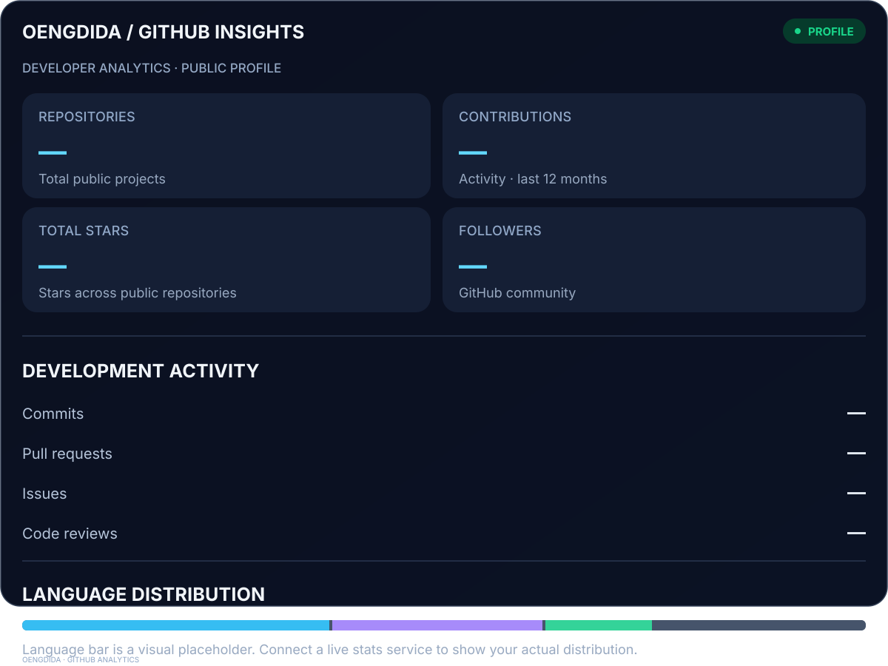

# Hey there! 👋 I'm Oeng Dida

### IT Student | Aspiring Software Engineer | Tech Enthusiast 🇰🇭

  

---

## 👨‍💻 About Me

- 🎓 Studying Information Technology at **National University of Management (NUM)**, Cambodia.
- 💻 Interested in Software Engineering, Web Development, Mobile Development, and Cybersecurity.
- 🌱 Currently developing my programming and problem-solving skills.
- 🚀 Enjoy building projects that solve real-world problems.
- 🎯 Working towards becoming a skilled software engineer.
- 🇰🇭 Based in Cambodia.

---

## 🛠️ Tech Stack

**Currently Learning & Exploring**

  

**Tools & Development Environment**

  

---

## 🚀 Projects

---

## 📊 GitHub Statistics

  

  
  

---

## 🤝 Connect With Me

  
  

---

  <i>"Every expert was once a beginner."</i>
    
  ⭐ Thanks for visiting my profile!
   
  

